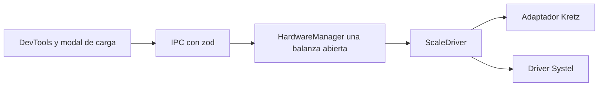

# Plan — Soporte Systel Cuora Max

Plan aprobado en chat (28/11/2026). **No implementado** salvo la documentación en esta rama.
Antes de codificar: leer [SYSTEL_IMPLEMENTACION_HANDOFF.md](./SYSTEL_IMPLEMENTACION_HANDOFF.md).

## Base

- Rama: `cursor/systel-cuora-max-ca23` desde `origin/rediseno-informacion` (0.6.19).
- Primer commit de código: etapa 1 (no mezclar etapas).

## Decisiones cerradas

Ver tabla completa en el handoff. Puntos clave: convivencia Kretz+Systel, prefijo pesable `23` vía F8, F61 layout 155, sync Systel con respaldo×5 y sobrantes solo admin, celu fuera de alcance.

## Contrato y encaje

- Contrato: `apps/desktop/electron/hardware/scale/scaleDriver.ts`
- Kretz: adaptador sobre `kretzDriver` / `r30Protocol` sin reescribir tramas; IPC `ipc:kretz-*` intacto.
- Nuevo IPC: `ipc:scale-*` con zod + tests.
- Tabla `scales` migración `0065`; migrar secreto `kretz-port` si la tabla está vacía.

## Driver Systel (resumen)

- Trama: `[addr byte][func byte][ASCII…][XOR]`; lectura hasta XOR válido (F31 en pedazos).
- Escritura PLU: **solo F61**, 155 bytes; protocolo **0060** y **D0**; no F4.
- Lectura: F23, F2, F39, F11, F31, F62, F5.
- Mock con trama de campo validada + F31 partida.

## Etapas (checklist)

Cada etapa: `pnpm test` verde. Campo: humano en el local.

| # | Entrega | Prueba en balanza |
|---|---|---|
| 1 | Codec, mock, contrato, adaptador Kretz | Solo tests |
| 2 | DevTools solo lectura F23, F2, F39, F11 | Dirección 20, `0060`, `D0`, sector 02 |
| 3 | Un PLU F61 + comparación F62 | PLU 999, $15.000, ACK |
| 4 | Modal F8 → `23PPPPIIIIII`, etiqueta escaneada | EAN-13 prefijo 23 |
| 5 | Parser caja/pedidos (shared) | Ticket Systel + Kretz |
| 6 | Tabla scales, detección, balanza activa | Detectar sin escribir |
| 7 | Sync masiva Systel | Respaldo, omitidos, sobrantes admin |

## Riesgos

- F8: PDF no detalla respuesta; validar con F39 y etiqueta impresa.
- F61 puede fijar EAN por PLU además del global F8.
- Ticket viejo con prefijo 20 se leería como Kretz (hoy solo prueba 999).
- F62: byte gestión + largo 156; validar en etapa 3 antes de sync.

## Todos de implementación

- [ ] Etapa 1 — codec + contrato + mock
- [ ] Etapa 2 — lectura DevTools
- [ ] Etapa 3 — F61 + F62
- [ ] Etapa 4 — F8 prefijo 23
- [ ] Etapa 5 — parser tickets
- [ ] Etapa 6 — scales + detección
- [ ] Etapa 7 — sync Systel